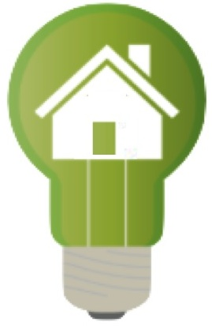

# Home Manager



**Home Manager** is a prototype platform for the control of an intelligent home, designed as a
multi-agent system and built on the [TuCSoN](https://apice.unibo.it/bin/view/TuCSoN/)
coordination infrastructure and on [tuProlog](https://apice.unibo.it/bin/view/tuProlog/), at
DISI, Alma Mater Studiorum – Università di Bologna. Each device in the house has an agent;
tuple centres hold the coordination laws that mediate among the users' preferences and pursue
the goals of the whole house, such as keeping the energy consumption down. From 2014 on it was
re-read in the *Butlers* perspective: agents that track the user, reason on the user's habits
and act ahead of them.

Its page on APICe: <https://homemanager.apice.unibo.it>.

This repository is **the Home Manager repository of 2014–2018, recovered**. It lived on
Bitbucket, at `bitbucket.org/tuprologteam/homemanager`, and was lost with it; Software Heritage
had archived it on 9 January 2021, and this is that archive, every commit, author, date and
branch, brought back into a working repository. [RECOVERY.md](RECOVERY.md) tells how, and what
could not be recovered.

## The history in the repository

The Bitbucket repository was the shared workbench of the theses on Home Manager: each student
worked on a `TH-<NAME>` branch, and the branch was merged into `master` when the thesis was
done. Roberta Calegari (committing as `tuProlog`) made the merges.

The tags mark where each thesis entered `master`; the date is the graduation day, from the
thesis record on APICe.

| tag | thesis | graduated | APICe |
|---|---|---|---|
| `th-barboni-2014` | Paolo Barboni, *Refactoring di un sistema prototipale per la gestione di una casa intelligente* | 2014-03-18 | [HomeManager2redesign](https://apice.unibo.it/bin/view/Thesis/HomeManager2redesign) |
| `th-bertoletti-2014` | Ilaria Bertoletti, *Riprogettazione ed estensione del prototipo del sistema Home Manager* | 2014-10-06 | [HomeManager2impl](https://apice.unibo.it/bin/view/Thesis/HomeManager2impl) |
| `th-celi-2015` | Alessandro Celi, *Smart home: reasoning e proattività applicate ad un caso di studio* | 2015-10-12 | [HMMeteoLT](https://apice.unibo.it/bin/view/Thesis/HMMeteoLT) |
| `th-bevilacqua-2015` | Sara Bevilacqua, *Home intelligence & social network in the Butlers perspective* | 2015-10-12 | [HMSocialLM](https://apice.unibo.it/bin/view/Thesis/HMSocialLM) |
| `th-carano-2015` | Matteo Carano, *Sperimentazione di tecnologie Raspberry in contesti di Home Intelligence* | 2015-10-12 | [HMRaspberryLT](https://apice.unibo.it/bin/view/Thesis/HMRaspberryLT) |
| `th-bruzzechesse-2016` | Simone Bruzzechesse, *Human presence detection in ambiente Home Manager: sperimentazione su piattaforma Raspberry*, on Jacopo Ameli's *Human presence detection: analisi comparativa e caso di studio in Home Manager* (2016-03-17) | 2016-07-14 | [HumanDetectionHM2016Raspberry](https://apice.unibo.it/bin/view/Thesis/HumanDetectionHM2016Raspberry), [HomeManagerAmeli2016](https://apice.unibo.it/bin/view/Thesis/HomeManagerAmeli2016) |
| `th-mora-2016` | Alessio Mora, *Home Manager Application su Android ART: progetto e realizzazione in ottica modern UI* | 2016-07-14 | [AndoridAppHomeManager2016](https://apice.unibo.it/bin/view/Thesis/AndoridAppHomeManager2016) |
| `th-fucili-gardini-scalzotto-2016` | Mattia Fucili, Erika Gardini, Luca Scalzotto: auto-detect, consumption control, smart kitchen, physical devices | 2016-10-06 | [GardiniHomeManager2016](https://apice.unibo.it/bin/view/Thesis/GardiniHomeManager2016), [HomeMaagerRaspberry](https://apice.unibo.it/bin/view/Thesis/HomeMaagerRaspberry) |
| `th-bertoletti-2017` | Ilaria Bertoletti, *Reasoning e apprendimento negli smart environment: un caso di studio* | 2017-06-15 | [HomeManPolicies](https://apice.unibo.it/bin/view/Thesis/HomeManPolicies) |
| `th-calvio-2018` | Alessandro Calvio, *Smart Environment su piattaforma Home Manager: sensori e micro-intelligenza* | 2018-10-03 | [LPaaSHM2018](https://apice.unibo.it/bin/view/Thesis/LPaaSHM2018) |
| `th-antognetti-2018` | Luca Antognetti, *Micro-Intelligenza in contesti Smart Home: realizzazione di un guardaroba intelligente* | 2018-10-03 | [HomeManagerWardrobeLPaaS](https://apice.unibo.it/bin/view/Thesis/HomeManagerWardrobeLPaaS) |

Barboni's code entered the repository after Bertoletti's first commit, on 2014-11-19.
`v0-bitbucket` is `master` as it was archived, the last commit of 29 November 2018.

Branches never merged into `master` are kept as they were:

| branch | work | last commit | APICe |
|---|---|---|---|
| `TH-POMETTO` | Attilio Pometto, transducers for the lights | 2015-12-14 | [PomettoButlers2015](https://apice.unibo.it/bin/view/Thesis/PomettoButlers2015) |
| `TH-MARZADURI` | Luca Marzaduri, a Java bridge and a C# TuCSoN agent for Raspberry Pi | 2016-01-24 | |
| `TH-MANCINI` | Armando Mancini, the smart oven | 2016-06-25 | [SmartOvenHM2016](https://apice.unibo.it/bin/view/Thesis/SmartOvenHM2016) |
| `TH-AMELI` | Jacopo Ameli, human presence detection (merged through `TH-BRUZZECCHESSE`; one later commit) | 2016-06-29 | [HomeManagerAmeli2016](https://apice.unibo.it/bin/view/Thesis/HomeManagerAmeli2016) |
| `TH-GAVA` | Federico Gava, scheduling of the appliances | 2016-09-28 | [HomeManagerScheduling](https://apice.unibo.it/bin/view/Thesis/HomeManagerScheduling) |
| `TH-CASADEI` | Richiard Casadei, Home Manager as IoT middleware: the fridge transducer and probes | 2016-12-01 | [CasadeiIoT2016](https://apice.unibo.it/bin/view/Thesis/CasadeiIoT2016) |
| `TH-FAVA` | Nicola Fava, the shopper agent | 2017-09-29 | [SmartKitchenHM2017](https://apice.unibo.it/bin/view/Thesis/SmartKitchenHM2017) |
| `TH-ANTOGNETTI` | Luca Antognetti, the smart wardrobe (its content entered `master` by copy) | 2018-10-02 | [HomeManagerWardrobeLPaaS](https://apice.unibo.it/bin/view/Thesis/HomeManagerWardrobeLPaaS) |
| `PR-BEVILACQUA` | Sara Bevilacqua's pull request, already in `master` | 2015-11-07 | [HMSocialLM](https://apice.unibo.it/bin/view/Thesis/HMSocialLM) |

Home Manager is older than this repository: it started around 2006–2009 (theses
[FontanTecAdAgentiPerCasaIntell06](https://apice.unibo.it/bin/view/Thesis/FontanTecAdAgentiPerCasaIntell06),
[DiCarloHomeManRBAC09](https://apice.unibo.it/bin/view/Thesis/DiCarloHomeManRBAC09); paper
[SodaIcaart2009](https://pubs.apice.unibo.it/SodaIcaart2009)), and that code is not here.

## What is in it

| folder | what it is |
|---|---|
| `HomeManager` | the platform: agents, tuple centres, the Swing interface (Eclipse project) |
| `MyAppHomeManager` | the Android app (Android Studio / Gradle 2.8 project, with its built APKs) |
| `SmartComponentInfrastructure` | the smart-component library and its LPaaS client (Eclipse) |
| `SmartFridge`, `SmartPantry` | the Raspberry Pi fridge and pantry (NetBeans) |
| `SmartMixer`, `SmartOven` | the Raspberry Pi mixer and oven (Eclipse) |
| `SmartWardrobe` | the Raspberry Pi wardrobe on LPaaS (Eclipse) |
| `TucsonPersistentFile` | tuple centres saved by TuCSoN in 2016–2017 |
| `.metadata` | an Eclipse workspace, as it was committed |
| `libreria WEKA.zip` | the WEKA library, as it was committed |

Everything was committed as the developers had it, built files included.

## Building it

```bash
./build.sh                # every Java part
./build.sh SmartOven      # only one
```

It needs **a Java 8 JDK** (`JAVA_HOME` pointing at it: on a Mac, Homebrew's `zulu@8` cask), as
in 2014–2018: `SmartFridge` and `SmartPantry` use `sun.misc.BASE64Encoder`, which later JDKs no
longer have. Each part is compiled from its own `src/` against the jars it carries; classes go
to `_build/`. Nothing is downloaded.

The **Android app is not rebuilt**: its Gradle 2.8 build and its Android plug-in no longer run on
today's tools. Its APKs, built at the time, are in `MyAppHomeManager/app/build/outputs/apk/` and
`MyAppHomeManager/bin/`.

Running Home Manager needs what it needed then: a TuCSoN node, and the devices or their
simulated agents. That has not been tried.

## Changes since the archive

Two commits follow `v0-bitbucket`:

- `v1-builds`: `build.sh`, and 15 sources re-encoded from Latin-1 to UTF-8 so that one encoding
  compiles them all. Their accented letters are in comments only, and their classes are
  byte-identical before and after. The code is unchanged.
- the repository around the code: this README, `RECOVERY.md` and `recovery/`, the CI, the
  notes.

## Publications

- [Extending a Smart Home Multi-Agent System with Role-Based Access Control](https://pubs.apice.unibo.it/HomeManITS2014) (2014)
- [Novel pervasive scenarios for home management: the Butlers architecture](https://pubs.apice.unibo.it/ButlersSpringerplus3) (2014)
- [Butler-ising HomeManager: A Pervasive Multi-Agent System for Home Intelligence](https://pubs.apice.unibo.it/HomeMan2icaart2015) (2015)
- [The Butlers Framework for Socio-Technical Smart Spaces](https://pubs.apice.unibo.it/HomeManagerInsci16) (2016)
- [Context Reasoning and Prediction in Smart Environments: the Home Manager case](https://pubs.apice.unibo.it/DCKES2017) (2017)

## License

The original README states that Home Manager is available under the
[GNU LGPL](https://www.gnu.org/licenses/lgpl.html); it names no version, and the repository has
no license file.

## The original README

As it was on Bitbucket (written 2014-10-14, last edited 2014-11-19):

<!-- markdownlint-disable MD034 -- the original, quoted verbatim -->

> Home Manager is a prototype application for the control of an intelligent home, designed as a multi-agent system via the [SODA](http://apice.unibo.it/xwiki/bin/view/SODA/) methodology, and implemented on top of the [TuCSoN](http://apice.unibo.it/xwiki/bin/view/TuCSoN/) coordination infrastructure.
>
> The system considers a house with independent devices (air conditioners, lights, etc.), each equipped with an agent to participate to the agent society. The coordination infrastructure, programmable via tuple centres, embeds the coordination laws required both to mediate among the different user's preferences and to pursue the overall system goals — in this case, to manage (limit) the overall energy consumption. More recently, the Home Manager system has been re-interpreted, given its goals and features, in the Butlers perspective: in particular exploiting the user's location — tracked in real time thanks to the GPS and the other geo-localisation techniques embedded in modern smartphones — to enable an intelligent reasoner agent to take some autonomous decisions (for instance, adjusting the air conditioner temperature), possibly even anticipating some user’s needs, managing the related devices on the user’s behalf (for instance, deducing the opportunity to switch on the oven, or post-pone the washing machine, etc.).
>
> The Home Manager system is available under [GNU LGPL](https://www.gnu.org/licenses/lgpl.html) license.
> Main Home Manager web page is http://apice.unibo.it/xwiki/bin/view/Products/HomeManager.
